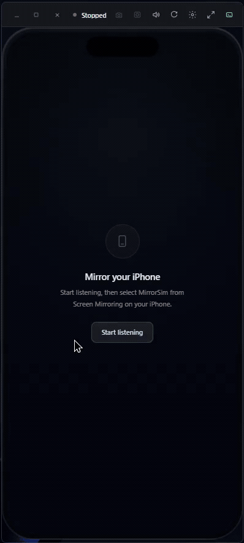
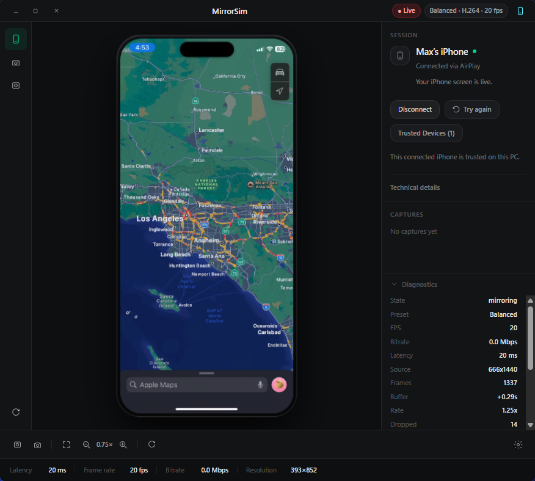
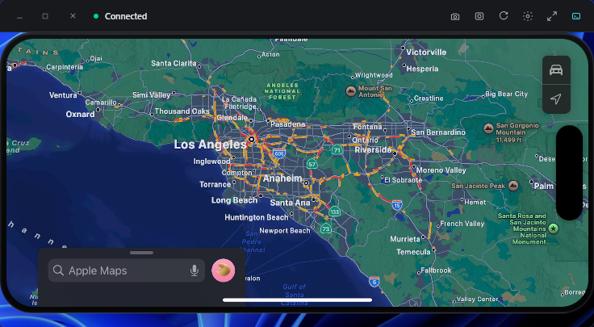

# MirrorSim

[](https://github.com/Mahcks/MirrorSim/releases/latest)
[](https://github.com/Mahcks/MirrorSim/actions)
[](LICENSE)
[](https://github.com/Mahcks/MirrorSim/releases/latest)


MirrorSim mirrors your iPhone screen **with live audio** over AirPlay into a clean device-frame window on Windows. It is free and open source, with no watermark, subscription, or account required. Record video with iPhone audio, take screenshots, or use the floating window for demos and walkthroughs — no cable or separate iPhone app needed.

**Audio playback and recording are supported. Bonjour for Windows is not required:** MirrorSim includes its own AirPlay receiver and network discovery.

<p align="center">
  
</p>

<p align="center">
  <a href="https://github.com/Mahcks/MirrorSim/releases/latest"></a>
  <a href="https://github.com/Mahcks/MirrorSim/releases/latest"></a>
</p>

> MirrorSim includes a bundled AirPlay receiver runtime built from a fork of [AirPlayServer by xenos1337](https://github.com/xenos1337/AirPlayServer). MirrorSim provides the desktop app, UI, capture tools, diagnostics, and release packaging around that receiver layer.

<details>
  <summary>Screenshots</summary>

  <p align="center">
    
  </p>

  <p align="center">
    
  </p>
</details>

---

## Why MirrorSim

Screen mirroring an iPhone on Windows usually means QuickTime on a Mac you don't have, a cable, or a generic receiver window full of chrome you have to crop out later. MirrorSim is built specifically for people who need a clean, reliable, real-hardware mirror of an iPhone on a Windows machine:

- **QA and bug repro on real hardware** — reproduce and capture issues on an actual iPhone, not a simulator, with diagnostics (buffer, rate, dropped/queued frames, last error) visible right in Console mode.
- **Product and marketing screenshots** — a clean device frame with no receiver chrome, ready to drop straight into a deck, store listing, or blog post.
- **App walkthroughs and tutorials** — record `.webm` walkthroughs of your app running on real iOS, not an emulator skin.
- **Live client and stakeholder demos** — Minimal mode gives you a floating, presentation-ready overlay you can screen-share without exposing the rest of your desktop.
- **Conference and presentation mirroring** — mirror to the room without a Lightning-to-HDMI dongle or a cable snaking to the podium.
- **Remote support and pairing sessions** — see exactly what a teammate or user sees on their device in real time, over Wi-Fi.
- **Content creation** — capture iPhone app footage for videos, tutorials, or social content directly to disk.

---

## Highlights

- Live iPhone screen mirroring over Wi-Fi
- Live iPhone audio playback with mute, master volume, iPhone volume following, and stereo or mono output
- Minimal floating device-frame mode for demos and recordings
- Console mode with connection state, diagnostics, capture history, and controls
- Receiver-driven portrait and landscape framing with a manual override that is not fooled by apps publishing a separate landscape video surface
- Screenshots to disk and/or clipboard, with an optional presentation-ready device frame
- Local `.webm` screen recordings with iPhone audio and an optional device frame
- Adjustable preview quality and live-edge catch-up presets
- Trusted-device preferences and receiver access controls
- Built-in mDNS discovery that follows active network interfaces without requiring Bonjour for Windows
- Optional always-on-top Minimal window, fullscreen, and customizable keyboard shortcuts
- In-app update checks and downloads, plus local diagnostics export for troubleshooting
- Local video and audio processing with no advertising, analytics, or cloud upload of mirrored content

---

## Requirements

- Windows 10 or later, x64
- iPhone and PC on the same Wi-Fi network
- Windows Firewall allowing MirrorSim on the network you are using

MirrorSim bundles its AirPlay receiver runtime in release builds. You do not need to install a separate receiver package.

---

## Install

### Unsigned beta builds

MirrorSim is currently distributed as an unsigned beta. Windows SmartScreen may warn on first launch. See the [code signing policy](CODE_SIGNING.md) for signing status.

To run the official GitHub release build:

1. Click **More info** on the SmartScreen warning.
2. Click **Run anyway**.

Only download MirrorSim from the official [GitHub Releases](https://github.com/Mahcks/MirrorSim/releases/latest) page. Release assets include SHA-256 checksums (`checksums.txt`) so you can verify the installer or portable zip before running it.

MirrorSim ships in two formats:

- **Installer**: best for most users. Installs MirrorSim like a normal desktop app.
- **Portable zip**: extract and run without a full install.

### Installer

1. Download the latest MirrorSim installer from [GitHub Releases](https://github.com/Mahcks/MirrorSim/releases/latest).
2. Run the installer.
3. Launch MirrorSim from Start or the desktop shortcut.

### Portable

1. Download the latest portable zip from [GitHub Releases](https://github.com/Mahcks/MirrorSim/releases/latest).
2. Extract it to a folder you control.
3. Run `MirrorSim.exe`.

## Code signing policy

MirrorSim is applying for free open-source Authenticode signing
through SignPath Foundation. The current installers remain unsigned until the
application is accepted and the release workflow is integrated. See the full
[code signing policy](CODE_SIGNING.md), including build provenance, signing
roles, bundled runtime handling, privacy, and verification details.

If approved: **Free code signing provided by SignPath.io, certificate by
SignPath Foundation.**

### Updates

Use **Preferences > Support > Check for updates** to check GitHub for a newer release. When an update is downloaded, finish the current mirroring or pairing session before choosing **Restart to update**. You can also download releases manually from [GitHub Releases](https://github.com/Mahcks/MirrorSim/releases/latest).

Update artifacts have verification signatures. These are separate from Windows code signing and do not remove SmartScreen warnings.

---

## Use MirrorSim

1. Launch MirrorSim.
2. Click **Start listening**.
3. On your iPhone, open Control Center.
4. Tap **Screen Mirroring**.
5. Choose the receiver name shown in MirrorSim, usually `MirrorSim`.
6. Approve the pairing/trust prompt if MirrorSim asks for it.

The live iPhone preview appears inside the device frame. Use Minimal mode when you want the clean floating overlay, or Console mode when you want diagnostics, settings, and capture history visible.

---

## Modes

**Minimal mode** is the showcase view: just the device frame, a compact title bar, and quick controls for capture, recording, audio, rotation, preferences, and switching back to Console.

**Console mode** is the control room: connection and discovery state, diagnostics, capture history, recording controls, trusted devices, and troubleshooting tools.

---

## Captures

By default, captures are saved under:

```text
Pictures/MirrorSim/
```

Default filenames:

- Screenshots: `mirrorsim_screenshot_YYYYMMDD_HHMMSS.png`
- Recordings: `mirrorsim_recording_YYYYMMDD_HHMMSS.webm`

Preferences let you choose whether screenshots save to disk, copy to clipboard, or both. Screenshot and recording settings have separate folders, filename prefixes, timestamp options, and device-frame options. Captures omit the device frame by default; recordings include iPhone audio by default.

## Audio

MirrorSim plays the audio received from your iPhone through your PC and can include it in `.webm` recordings. Open **Preferences > Audio** to configure:

- **Play iPhone audio**: enable or mute local playback; `M` also toggles mute.
- **Follow iPhone volume buttons**: use the iPhone's volume level for playback.
- **MirrorSim master volume**: adjust the app's playback level independently of Windows system volume.
- **Audio channel output**: choose Stereo or Mono compatibility.
- **Include iPhone audio in recordings**: include or omit audio in new recordings.

Playback is enabled by default, with iPhone volume following, an 80% master level, and stereo output. Muting playback or lowering its volume does not mute or lower recorded audio: recordings use the full-level received iPhone audio when recording audio is enabled.

## Preferences and device access

- Choose the default view, remember the last view and orientation, follow iPhone rotation, or keep the Minimal window always on top.
- Change the Screen Mirroring receiver name and preview quality, or enable a solid window background.
- Under **Connection**, enable listening when MirrorSim opens, configure automatic reconnection, or refresh discovery after network changes.
- Choose whether to ask each time a new iPhone connects, remember approved iPhones, or allow only known iPhones. Manage saved devices with nicknames and blocking controls.
- Under **Support**, customize shortcuts, export diagnostics, check for updates, and open project or issue links.

---

## Keyboard Shortcuts

These are the defaults. In-app shortcuts can be changed under **Preferences >
Support > Keyboard Shortcuts** and reset at any time.

| Shortcut | Action |
| --- | --- |
| `M` | Mute or unmute iPhone audio |
| `Ctrl+S` | Take screenshot |
| `Ctrl+R` | Toggle recording |
| `Ctrl+F` or `F` | Toggle fullscreen |
| `Ctrl+M` | Toggle Console/Minimal mode |
| Double-click the device | Toggle fullscreen |
| `F1` | Toggle diagnostics, switching to Console mode if needed |
| `H` | Hide or show the Minimal mode toolbar |
| `Ctrl+,` | Open Preferences |
| `Esc` | Close the active dialog or context menu, or leave fullscreen |

---

## Preview Presets

Preview presets tune the desktop playback surface. They do not change the iPhone's AirPlay stream quality directly; they adjust scaling and how aggressively MirrorSim catches up to the live edge after small stalls or sleep/wake hiccups.

| Preset | Best for | Behavior |
| --- | --- | --- |
| High quality | Demos and review | Smooth scaling with a slightly steadier preview |
| Balanced | Everyday use | A practical balance between clarity and latency |
| Fast | Lowest latency | More aggressive live-edge catch-up and pixelated scaling |

---

## Current Limitations

MirrorSim supports screen mirroring with audio playback and recording. The remaining limitations include:

- DRM-protected video may appear black while player controls and audio continue. MirrorSim cannot decrypt protected video, and its protected-playback warning is an estimate rather than a definitive DRM check. Return to normal Screen Mirroring or use the streaming service's Windows app for protected playback.
- Automatic rotation depends on orientation information from the bundled receiver. MirrorSim follows the iPhone screen shape rather than a separate video player's dimensions; Rotate remains available as a temporary override.
- Built-in mDNS removes the Bonjour dependency and follows interface changes, but guest Wi-Fi isolation, VPNs, and Windows Firewall rules can still block local AirPlay traffic.
- MirrorSim preserves ordinary interrupted mirror-data sessions for up to two minutes. An explicitly paused sender remains available while iOS keeps the AirPlay control session alive, but iOS can still terminate that session during longer sleep or network changes.

---

## Troubleshooting

### iPhone does not see MirrorSim

- Put the iPhone and PC on the same Wi-Fi network.
- Allow MirrorSim through Windows Firewall on private networks.
- Avoid VPNs, proxies, or VM/NAT networking while testing discovery.
- In Preferences > Connection, use **Refresh discovery** after changing Wi-Fi or firewall settings.

MirrorSim advertises AirPlay directly with its built-in mDNS service and can open Windows Firewall settings for you.

### Session connects but stays blank or gets delayed

- Open Console mode and expand diagnostics.
- Watch `Buffer`, `Rate`, `Dropped`, `Queued`, `Init`, `Appended`, and `Last error`.
- Try the **Fast** preview quality setting for lower latency.
- Disconnect and reconnect the iPhone from Control Center if iOS resumes from sleep in a bad state.
- Restart MirrorSim if the native receiver runtime has been left running from an older dev build.

### Screenshots or recording are not available

The preview must be live and decodable before capture works. If MirrorSim says the live preview is not ready, wait for the iPhone frame to appear or reconnect the session.

### iPhone audio is silent

- Make sure MirrorSim is not muted and its master volume is above zero.
- If **Follow iPhone volume** is enabled, raise the volume on the iPhone.
- Select the speaker control once if Windows has paused audio playback until you interact with the app.

---

## Tech Stack

Tauri 2, Rust, React, TypeScript, Tailwind CSS, and a bundled native AirPlay receiver runtime.

---

## Contributing

Want to build MirrorSim from source, work on a fix, or cut a release? See [CONTRIBUTING.md](CONTRIBUTING.md) for local dev setup, the AirPlay runtime workflow, and release/build instructions.

For support and project policies:

- Use the [bug report form](https://github.com/Mahcks/MirrorSim/issues/new?template=bug-report.yml) for reproducible problems and attach a reviewed diagnostics export when it is safe to share.
- Use the [feature request form](https://github.com/Mahcks/MirrorSim/issues/new?template=feature-request.yml) for proposed improvements and new workflows.
- Read the [privacy statement](PRIVACY.md) for details about local media processing, network activity, diagnostics, and retained application data.
- Follow the [security policy](SECURITY.md) to report suspected vulnerabilities privately.
- Review the [code signing policy](CODE_SIGNING.md) for release provenance and Authenticode status.

---

## Credits

MirrorSim depends on work from the AirPlay reverse-engineering and open-source desktop media communities.

- [AirPlayServer](https://github.com/xenos1337/AirPlayServer) by xenos1337
- [airplay2-win](https://github.com/fingergit/airplay2-win) by fingergit
- mDNS discovery, FFmpeg, SDL2, and related libraries used by the bundled receiver runtime

MirrorSim itself is licensed under MIT. The bundled AirPlay receiver runtime includes separate terms and source links documented in [`THIRD_PARTY_NOTICES.md`](THIRD_PARTY_NOTICES.md) and `LICENSES/`.

Apple, AirPlay, and iPhone are trademarks of Apple Inc. MirrorSim is an independent project and is not affiliated with or endorsed by Apple Inc.
